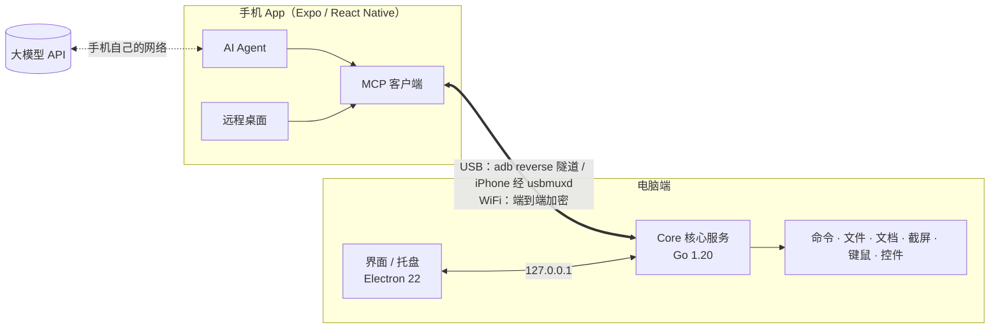

<div align="center">

# P2D

（原名 PhoneToDesktop）

用手机通过一根数据线控制电脑：手机上的 AI Agent 帮你执行命令、读写文件、看屏幕、操作鼠标键盘，也可以手动远程桌面。

电脑不需要联网，支持 Windows 7 / 10 / 11、银河麒麟和 macOS；手机支持 Android 和 iPhone。

[](https://github.com/chxcodepro/p2d/actions/workflows/build.yml)
[](https://github.com/chxcodepro/p2d/releases)


[](LICENSE)

[安装说明](docs/INSTALL.md) · [下载](https://github.com/chxcodepro/p2d/releases) · [开发说明](docs/DEV.md) · [通信协议](docs/PROTOCOL.md)

</div>

## 目录

- [特性](#特性)
- [支持的平台](#支持的平台)
- [快速开始](#快速开始)
- [工作原理](#工作原理)
- [从源码构建](#从源码构建)
- [项目结构](#项目结构)
- [文档](#文档)
- [参与贡献](#参与贡献)
- [许可证](#许可证)
- [友情链接](#友情链接)

## 特性

- **只用数据线**：手机插上电脑就自动连接，电脑不需要网络、WiFi、蓝牙。电脑端会自动给手机安装、更新 App。
- **iPhone**：iPhone 上装好 App 后，插数据线（经系统的 usbmuxd：Mac 自带，Windows 装「Apple 设备」，麒麟装 usbmuxd）或 WiFi 连接电脑。
- **免调试连接（麒麟）**：手机不开 USB 调试也能用数据线连接（Android 配件模式），第一次在电脑端点一下「免调试连接」，以后插上自动连。
- **AI Agent**：手机负责调用大模型（自己的网络、自己的 API Key），电脑只负责执行，模型 Key 不会留在电脑上。
- **电脑端能力**：执行命令（可申请管理员权限）、浏览 / 搜索 / 读写文件、读取 Word / Excel / PPT / PDF / WPS 文档、截屏、鼠标键盘（支持中文输入）、读取和操作界面控件（Windows）。
- **远程桌面**：手机上实时查看并操作电脑屏幕。
- **多台电脑**：同时连接几台电脑，在一个对话里让 Agent 指定某台或几台一起操作（不同电脑并行执行），还能在电脑之间传文件。
- **权限由手机控制**：只读 / 标准 / 完全控制三档，可以单独关闭命令、文件、屏幕、键鼠。电脑屏幕四周出现红框表示正在被控制，随时可以用热键断开。
- **WiFi 直连（可选）**：配对后可以在同一局域网内无线连接，全程端到端加密；也支持通过 Tailscale 远程连接。
- **扩展**：支持远程 MCP、电脑上的 stdio MCP 和 Skill，支持定时任务（可以指定在哪几台电脑上执行）。
- **安装简单**：Windows 是一个安装程序（不需要管理员权限），不需要 adb（电脑端自己通过 USB 和手机通信），自带 USB 驱动；麒麟用 deb 安装。支持开机自启和检查更新。

## 支持的平台

| 端 | 系统 | 安装包 |
|---|---|---|
| 手机 | Android（arm64 / armv7） | `P2D-<版本>-android.apk` |
| 电脑 | Windows 10 / 11、Windows 7 SP1（x64 / x86） | `P2D-<版本>-win-x64-setup.exe` / `-win-ia32-setup.exe`（安装程序） |
| 电脑 | 银河麒麟 V10 arm64（飞腾、鲲鹏、海思麒麟） | `P2D-<版本>-linux-arm64.deb` |
| 电脑 | 银河麒麟 V10 x86_64（兆芯、海光、Intel） | `P2D-<版本>-linux-amd64.deb` |
| 电脑 | 银河麒麟 V10 龙芯 3A5000 / 3A6000 | `P2D-<版本>-linux-loongarch64.deb` |
| 电脑 | macOS 10.13 及以上（Apple 芯片 / Intel） | `P2D-<版本>-mac-arm64.dmg` / `-mac-x64.dmg` |
| 手机 | iPhone（iOS 16.4 及以上） | `P2D-<版本>-ios-unsigned.ipa`（未签名，要自己签名安装） |

暂不支持：龙芯 3A4000（mips64el）、申威（sw64）。Mac 版和 iPhone 版还没有真机测试，也没有苹果开发者签名，安装方法见 [安装说明](docs/INSTALL.md)。

## 快速开始

1. 从 [Releases](https://github.com/chxcodepro/p2d/releases) 下载对应电脑的安装包。
2. 电脑上运行：
   - **Windows**：把 exe 放到固定的目录（不要直接在 U 盘里运行），双击运行。
   - **银河麒麟**：

     ```bash
     sudo dpkg -i P2D-<版本>-linux-arm64.deb
     ```

     然后双击桌面上的「P2D」图标。
3. 手机打开「开发者选项 → USB 调试」，用数据线连接电脑，在手机上点「允许 USB 调试」。
   麒麟电脑也可以不开 USB 调试：手机上先装好 App，插线后在电脑端窗口点「免调试连接」（见 [安装说明](docs/INSTALL.md)）。
4. 电脑端会自动给手机安装 App 并连接，窗口显示「已连接」即可在手机上操作电脑。
5. 使用 Agent 前，在手机 App「设置 → 模型」里填写大模型的接口地址和 API Key。

详细步骤（Win7 驱动、麒麟安全中心、防火墙、Tailscale、更新）见 [安装说明](docs/INSTALL.md)。

## 工作原理



- 电脑是「手脚」，手机是「大脑」：所有推理在手机侧完成，电脑端只暴露一组 [MCP](https://modelcontextprotocol.io/) 工具。
- Core 用 Go 1.20 编译（最后一个支持 Win7 的版本），单文件、不依赖系统运行库；界面用 Electron 22（最后一个支持 Win7 的版本）。
- 协议细节见 [docs/PROTOCOL.md](docs/PROTOCOL.md)，技术方案见 [docs/PLAN.md](docs/PLAN.md)。

## 从源码构建

推送到 GitHub 后，[GitHub Actions](.github/workflows/build.yml) 会自动测试并构建全部平台的安装包；推送 `v` 开头的标签会创建 Release。

本地构建需要：Go 1.20.x、Node.js 24、JDK 17（构建 APK）。

```bash
# 电脑端 Core：交叉编译全部平台，输出到 dist/core/
bash scripts/build-core.sh 0.1.0-dev

# 电脑端界面：打包 Windows 安装程序
cd desktop/app && npm ci && npm run dist:win64

# 手机端：类型检查和测试
cd mobile && npm ci && npx tsc --noEmit && npm test
```

APK 签名、麒麟各 CPU 的打包方式、调试方法等见 [开发说明](docs/DEV.md)。

## 项目结构

```
.
├── desktop/
│   ├── core/        # 电脑端核心服务（Go）：MCP 服务端、数据线自动连接（自己实现的 ADB 协议、iPhone 经 usbmuxd）、工具实现
│   ├── app/         # 电脑端界面（Electron + React）：窗口、托盘、被控红框
│   └── vendor/      # 打包时内置的手机端 APK（构建产物）
├── mobile/          # 手机端 App（Expo + expo-router + NativeWind，Android 和 iOS）
├── scripts/         # 构建、打包脚本
├── docs/            # 安装说明、开发说明、方案、协议、测试记录
└── .github/         # CI：测试、构建、发布
```

## 文档

| 文档 | 内容 |
|---|---|
| [INSTALL.md](docs/INSTALL.md) | 安装、使用、更新、已知限制 |
| [DEV.md](docs/DEV.md) | 开发环境、构建、签名、发布 |
| [PROTOCOL.md](docs/PROTOCOL.md) | 手机和电脑之间的通信协议、工具列表、权限 |
| [PLAN.md](docs/PLAN.md) | 技术方案 |
| [TESTING.md](docs/TESTING.md) | 各平台测试记录 |

## 参与贡献

欢迎提交 Issue 和 Pull Request。

- 提交前请运行对应部分的测试：`desktop/core` 下 `go test ./...`，`mobile` 下 `npm test`，`desktop/app` 下 `npm run typecheck`。
- 电脑端必须能在 Windows 7 和银河麒麟（含龙芯）上运行：不要升级 Go 1.20 和 Electron 22，引入的第三方组件需要所有平台都能用。Mac 版的截图、键鼠、USB 用 cgo 调用系统框架，只能在 Mac 上编译（CI 的 core-mac 任务）。
- 请不要提交签名证书、API Key 等敏感信息。

## 许可证

本项目以 [MIT 许可证](LICENSE) 开源。

## 友情链接

[](https://linux.do)

- [LINUX DO](https://linux.do)：新的理想型社区
